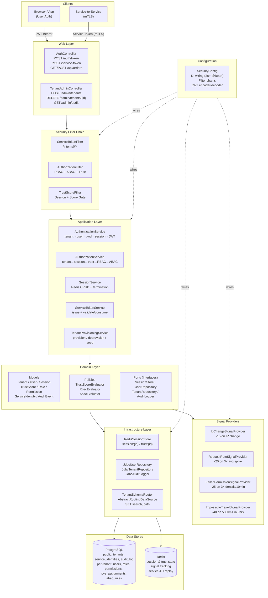
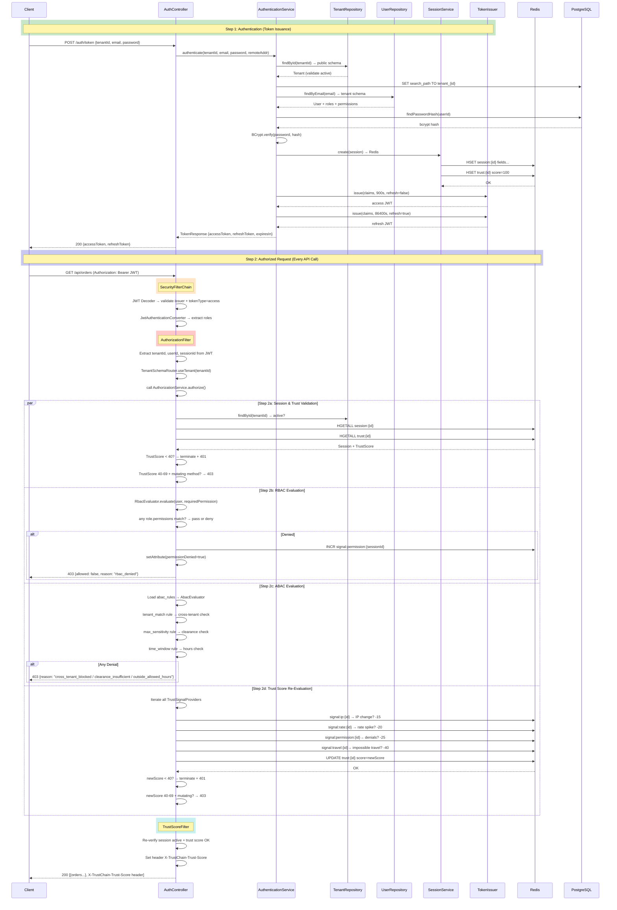
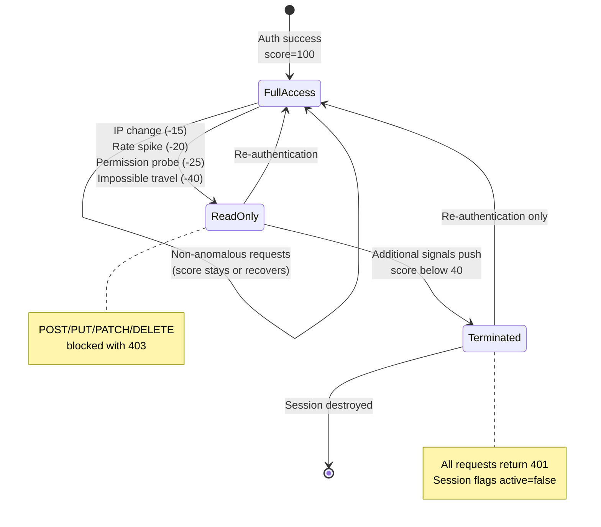
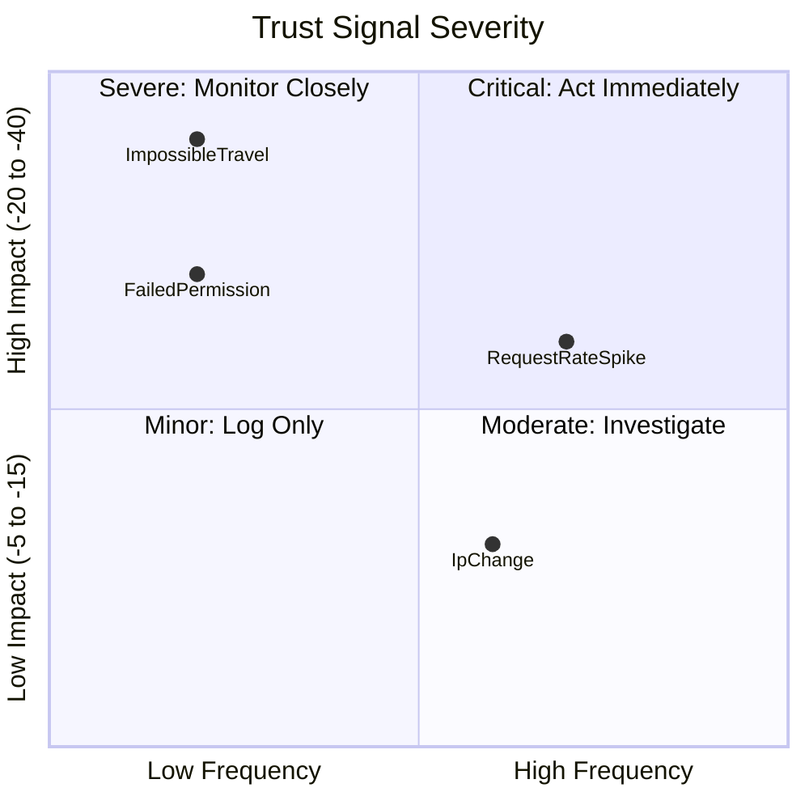

# TrustChain Architecture & Workflow

## Architecture Diagram

## Authentication & Authorization Workflow

## Trust Score Lifecycle

## Signal Provider Impact

## Key Design Decisions

- **Every request is fully evaluated** — JWT validity alone is insufficient; trust score, RBAC, and ABAC are checked on every API call
- **Schema-per-tenant isolation** — physical PostgreSQL schema separation via `search_path` routing prevents cross-tenant data access at the connection level, enforced by `TenantSchemaRouter`
- **Score recovery is capped** — trust score cannot recover above 80 without re-authentication, preventing score farming
- **Service tokens are single-use** — JTI replay protection via Redis `SETNX` with TTL matching remaining token validity
- **Audit trail** — every auth decision (allowed/denied) is persisted to `audit_log` with session, user, action, resource, outcome, and reason
